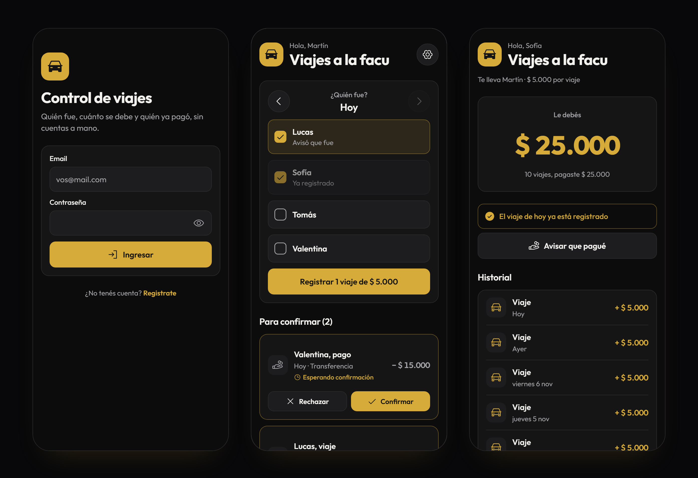

# Control de viajes

App para llevar la cuenta de los viajes compartidos: quién fue cada día, cuánto le debe cada uno al que maneja y quién ya pagó. Funciona en Android, iPhone y en la web.

**[Abrir la app → viajes.genesiscodestudio.com](https://viajes.genesiscodestudio.com)**



## Por qué existe

Un amigo nos lleva a la facultad y le pagamos la nafta por viaje. Primero hice un programa de escritorio en Python ([`viajes.py`](#historia)) para que él registrara quién iba, pero tenía dos problemas:

- Solo funcionaba en su compu. Si no la prendía, se olvidaba de anotar el día.
- Los pasajeros no veíamos nada: cada uno seguía haciendo la cuenta a mano.

Esta versión vive en la nube y cada uno la abre desde su teléfono o la compu.

## Cómo funciona

**El que maneja**
- Crea el grupo, define el precio por viaje y les pasa a los demás un código de 6 números.
- Cada día tilda quién fue y lo registra con un toque. También puede cargar días anteriores.
- Confirma o rechaza los avisos de los pasajeros.
- Ve el saldo de cada uno, registra los pagos que recibe y anula lo que se cargó por error.
- Cambia el precio cuando sube la nafta. Los viajes ya registrados guardan el precio que tenían.
- Trae las cuentas de la app vieja: pega el `historial.json` (o el `deudas.json`) de `viajes.py`, elige quién es quién y se cargan los viajes, pagos o deudas anteriores.

**Los pasajeros**
- Ven su saldo y su historial.
- Si el que maneja se olvidó de cargar el día, tocan **"Hoy fui"** y él lo confirma.
- Avisan cuando pagan. El saldo baja recién cuando el que maneja lo confirma.

Los cambios aparecen al instante en todos los teléfonos (tiempo real de Supabase).

## Tecnologías

- **[Expo](https://expo.dev) (React Native)** con TypeScript y Expo Router: un solo código para Android, iOS y web.
- **[Supabase](https://supabase.com)**: login con email, base de datos Postgres y tiempo real.
- **Netlify** para la versión web.

## Seguridad

Toda la lógica que importa está en la base de datos, no en la app:

- **Las tablas solo se pueden leer**, y con reglas de RLS cada uno ve únicamente lo suyo. Un pasajero no ve los pagos de los demás.
- **Todo lo que escribe pasa por funciones de Postgres** que validan quién las llama. Por ejemplo, el precio de un viaje siempre sale del grupo y no de lo que mande la app, y solo el que maneja puede confirmar.
- **El saldo es una vista** (`saldos`) que se calcula con viajes y pagos confirmados. No hay un número guardado que se pueda desincronizar.
- Una persona no puede tener dos viajes el mismo día (índice único en la base).

El esquema completo está en [`supabase/migrations`](supabase/migrations).

## Cómo levantarla

1. Creá un proyecto en Supabase y ejecutá los archivos de `supabase/migrations` en orden, desde el SQL Editor o con `supabase db push`.
2. Copiá `.env.example` como `.env.local` y completá la URL y la *publishable key* del proyecto.
3. Instalá y arrancá:

```bash
npm install
npx expo start
```

Con la app **Expo Go** escaneás el QR para abrirla en el teléfono, o apretás `w` para la versión web.

### APK para Android

Con [Android Studio](https://developer.android.com/studio) instalado:

```bash
npx expo prebuild --platform android
cd android
./gradlew assembleRelease
```

El APK queda en `android/app/build/outputs/apk/release/app-release.apk`. Lleva adentro los datos de `.env.local`, así que hay que completarlo antes de compilar.

### Logo propio (opcional)

Si ponés `logo.png` (cuadrado, 256 px o más), `icon.png` (1024 px) y `favicon.png` en `assets/local/`, la app los usa como marca, ícono y favicon. Esa carpeta está en el `.gitignore`, así que no se sube: sin ella la app muestra la marca por defecto. Después de agregarlos, reiniciá con `npx expo start --clear`.

## Estructura

```
src/
├── app/                 Pantallas (cada archivo es una ruta)
│   ├── _layout.tsx      Navegación: qué pantallas ve cada uno según su rol
│   ├── ingresar.tsx · registro.tsx
│   ├── empezar.tsx      Crear grupo o unirse con el código
│   ├── chofer/          Panel del que maneja, ajustes y detalle de cada pasajero
│   └── pasajero.tsx     Saldo, "Hoy fui", avisar pago e historial
├── components/          Botones, campos, tarjetas e historial
├── context/sesion.tsx   Sesión, perfil, grupo y rol
└── lib/                 Cliente de Supabase, datos en tiempo real, formatos y colores
supabase/migrations/     Tablas, reglas de acceso y funciones
docs/capturas/           Capturas del README (datos de ejemplo)
```

## Historia

La primera versión fue `viajes.py`, una app de escritorio con CustomTkinter que guardaba todo en un JSON en la compu del que manejaba. Después probé Flutter y terminé haciéndola en React Native porque ya trabajaba con React.

---

Hecho por Lautaro Cuello · [Genesis CodeStudio](https://genesiscodestudio.com)
